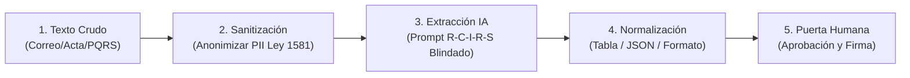

# Estación 03: Automatización de Flujos Documentales y Tratamiento de Información No Estructurada
**Programa:** Implementación de herramientas de inteligencia artificial en la optimización de la productividad (21720210 V1)  
**Ambiente de Formación:** Redes CIMI · SENA Girón  
**Fase Pedagógica:** Apropiación (Parte 1) · **Duración:** 10 horas (Laboratorio Práctico)  
**Resultado de Aprendizaje (RAP):** RA1. Establecer uso de la inteligencia artificial según requerimientos de optimización del proceso productivo.  
**Evidencia Asociada:** MG-A03 (Evidencia de Desempeño - Pipeline Asistido de Gestión Documental)

---

## 1. Tratamiento de Información No Estructurada en la Gestión Pública

El mayor porcentaje de la información que ingresa a una coordinación administrativa del SENA corresponde a **datos no estructurados**: correos electrónicos extensos, transcripciones de comités de evaluación, quejas ciudadanas escritas con redacción confusa y archivos escaneados.

Tradicionalmente, un funcionario debe leer manualmente cada línea, interpretar el sentido, extraer los datos en una libreta o Excel, y luego redactar una respuesta.  

En esta estación implementamos un **Pipeline Asistido de 5 Capas** para convertir texto libre en datos estructurados y borradores automáticos, asegurando trazabilidad y cero pérdida de información.



---

## 2. Laboratorio 1: Procesamiento de Transcripciones Complejas de Reuniones

### El Desafío
En el [Caso de Estudio 03: Transcripción de Reunión Caótica](file:///c:/Users/Miguel/Documents/Aplicaciones/_projects/Guia%20IA%20para%20Administrativos/docs/ejercicios/caso-03-acta-reunion-caotica.md), los coordinadores e instructores de Redes CIMI discuten múltiples temas entremezclados: alistamiento del ambiente, fallo de switches, quejas de aprendices, contratos de instructores y compras de fibra para 2027.

### Procedimiento de Implementación (Ciclo Iterativo V.E.R.A.)

Para garantizar el aprendizaje profesional y evitar el síndrome del "copiar y pegar rápido", este laboratorio exige múltiples iteraciones:

**Iteración 1: Ejecución Inicial (Provocando el Fallo)**
1. Envíe a la IA el texto del caso de estudio con una instrucción genérica y débil: *"Haz un resumen de esta reunión y dime qué toca hacer"*.
2. **Revisar:** Analice críticamente el resultado. ¿Qué falló? (¿Atribuyó tareas a quien solo preguntó? ¿Omitió fechas? ¿Confundió a los instructores?). Documente estos fallos en su plantilla de productividad (Evidencia MG-A05).

**Iteración 2: Blindaje R-C-I-R-S**
3. Redacte un nuevo prompt estructurado aplicando la arquitectura R-C-I-R-S y delimitadores XML.
4. Utilice el siguiente borrador como base y complételo:

```text
Actúa como Secretario Técnico de Comités del SENA CIMI.
Analiza la transcripción de la reunión delimitada entre <reunion> y </reunion>.

Genera exclusivamente dos artefactos:
1. TABLA DE COMPROMISOS OPERATIVOS con las columnas:
   | No. | Compromiso Específico | Responsable Directo (Nombre Exacto) | Fecha y Hora Límite | Precondición o Recurso |
2. MATRIZ DE RIESGOS Y ALERTAS con las columnas:
   | Alerta Identificada | Dependencia Involucrada | Acción Inmediata Requerida |

REGLAS DE RIGOR:
- [INSERTE RESTRICCIÓN PARA EVITAR QUE QUIEN PREGUNTE SE ASIGNE LA TAREA]
- [INSERTE RESTRICCIÓN SOBRE FECHAS INEXACTAS]
```

**Iteración 3: Verificación Crítica y Atribución**
5. **Verificar:** Compruebe que la tarea de llamar a los instructores contratistas atrasados con las notas (`Carlos, Andrea y Javier`) fue asignada a **Claudia Duarte**, mientras que a **Gloria Rojas** se le asignó consolidar las horas el lunes 2 de noviembre y tramitar la salida de cable en almacén.
6. Si la IA mezcló a Claudia con Gloria, ejecute una tercera iteración ajustando el prompt (añadiendo una restricción anti-alucinación explícita sobre nombres). Documente este refinamiento.

---

## 3. Laboratorio 2: Pipeline de Clasificación y Borrador de PQRS Masivas

Utilizando el [Caso de Estudio 02: Conjunto de PQRS](file:///c:/Users/Miguel/Documents/Aplicaciones/_projects/Guia%20IA%20para%20Administrativos/docs/ejercicios/caso-02-dataset-pqrs-desordenadas.md):

### Procedimiento de Implementación (Ciclo Iterativo V.E.R.A.)

1. **Iteración 1: Ejecución Inicial (Provocando el Fallo)**
   - Cargue las 5 PQRS en una sesión limpia.
   - Utilice un prompt sencillo: *"Clasifica estas 5 quejas del SENA y redacta una respuesta para cada una"*.
   - **Revisar:** Observe los resultados. ¿La IA redactó las respuestas con un tono inadecuado? ¿Clasificó mal los tipos de solicitud (Petición de Información vs Queja)? ¿No tuvo en cuenta los tiempos de ley? Documente los errores en su plantilla de evidencias.

2. **Iteración 2: Blindaje y Generación de la Matriz**
   - Construya un nuevo prompt con estructura R-C-I-R-S.
   - En el **[CONTEXTO]**, especifique la diferencia entre Petición de Documentos (10 días) y Petición de Información (15 días) según la Ley 1755 de 2015.
   - Solicite que **solamente** se genere una Matriz de Enrutamiento (Tabla) con las columnas: ID, Remitente Anonimizado, Tipología, Dependencia de Destino, Plazo Legal y Estado.
   - **Ejecutar TDD (Test-Driven Development):** Valide que la IA asignó correctamente el caso `PQRS-003` (Cédula retenida) a Coordinación Académica con el plazo legal adecuado.

3. **Iteración 3: Borrador Institucional Asistido**
   - En la *misma sesión* (para aprovechar el contexto), o en una nueva (para evitar deriva, dependiendo de lo que haya decidido en su estrategia), redacte un prompt específico para el caso `PQRS-001` (paz y salvo de biblioteca).
   - Indique en las **[RESTRICCIONES]** que la carta debe solicitar explícitamente el "paz y salvo previo de biblioteca con la plantilla oficial del CIMI", manteniendo un tono solemne.
   - **Atribuir y Aprobar (HITL):** Lea la respuesta generada. Verifique que no se asumen compromisos por fuera de la política de la entidad. Edite manualmente si es necesario (el humano siempre firma).

---

## 4. Taller Autónomo y Registro de Evidencia MG-A03

El aprendiz debe demostrar en su computador la ejecución del flujo asistido y registrar:

1. **Acta Ejecutiva Generada del Caso 03:**
   - Resumen ejecutivo por temas de agenda.
   - Tabla completa de compromisos verificada y contrastada.
2. **Matriz de Enrutamiento de las 5 PQRS del Caso 02:**
   - Tabla consolidada con: ID, Remitente Anonimizado, Tipología, Dependencia de Destino, Plazo Legal según Ley 1755 de 2015 y Estado.
3. **Borrador de Comunicación Oficial Asistido:**
   - Texto final de respuesta formal para el caso de mayor urgencia (`PQRS-002`), redactado en tono solemne SENA y respetando el debido proceso del aprendiz.
4. **Registro de Tiempos de Ejecución:**
   - Tiempo invertido manualmente vs. tiempo con el pipeline de IA (demostración de la ganancia de productividad).

### Lista de Chequeo de Aceptación (Criterio de Evaluación RA1)
- [ ] La tabla de compromisos extraída refleja fielmente la reunión sin inventar acuerdos inexistentes.
- [ ] No hay confusión de responsables entre los intervinientes de la reunión.
- [ ] La clasificación de las PQRS cita correctamente los términos legales de la Ley 1755 de 2015.
- [ ] Los borradores generados cumplen con el manual de estilo y redacción institucional del SENA.
