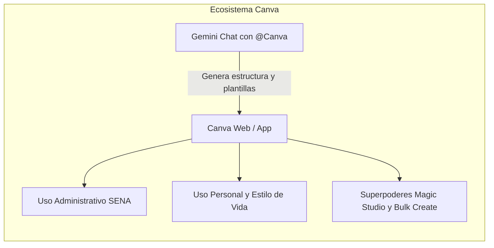

> **ARCHIVO HISTÓRICO — NO USAR COMO MATERIAL DE ESTA COHORTE.** Este contenido fue preparado para Redes CIMI/Girón y no se ha validado para la propuesta de cohorte del CGAO, Subsede Vélez, Regional Santander. Para esta formación use la [guía vigente](../index.html), la [cartilla de aprendices](Documentos/Cartilla_aprendices_retos_IA_SENA_Bogota.docx), el [libro de práctica](Documentos/Materiales_practica_IA_SENA_Bogota.xlsx) y la [guía de herramientas y preparación](herramientas-y-preparacion.md). No cargue datos personales o institucionales reales en servicios de IA externos. Funciones, nombres y permisos de herramientas pueden cambiar; verifique el acceso con el equipo formador.

# Guía Maestra: Dominio de Google Gemini y Subherramientas para la Gestión Administrativa y la Vida Diaria
**Especialmente diseñada para Funcionarios Administrativos del SENA y Gestores de Alto Volumen de Información**  
*Autores:* Especialistas en Productividad con Inteligencia Artificial · Redes de Gestión Administrativa SENA  
*Marco Normativo:* Ley 1755 de 2015 (PQRS), Ley Estatutaria 1581 de 2012 (Protección de Datos Personales), Acuerdo 007 de 2012 (Reglamento del Aprendiz SENA).

---

## Índice General
1. [Radiografía del Trabajo Administrativo en el SENA: Diagnóstico y Oportunidad](#1-radiografía-del-trabajo-administrativo-en-el-sena)
2. [El Ecosistema Google Gemini: Cómo Operar el Chat según la Necesidad](#2-el-ecosistema-google-gemini)
3. [Guía Exhaustiva de Canva: En Gemini, en la Administración, en la Vida y en General](#3-guía-exhaustiva-de-canva)
   - 3.1 [Extensión de Canva dentro de Gemini (@Canva)](#31-extensión-de-canva-dentro-de-gemini-canva)
   - 3.2 [Canva en el Área Administrativa (SENA e Instituciones)](#32-canva-en-el-área-administrativa)
   - 3.3 [Canva para la Vida Cotidiana y Personal](#33-canva-para-la-vida-cotidiana-y-personal)
   - 3.4 [Canva en General: Herramientas Ocultas y Magic Studio](#34-canva-en-general-herramientas-ocultas-y-magic-studio)
4. [Generador de Imágenes de Gemini (Imagen 3): Guía Práctica de Uso](#4-generador-de-imágenes-de-gemini-imagen-3)
5. [Generación y Análisis de Video con Gemini y @YouTube](#5-generación-y-análisis-de-video-con-gemini-y-youtube)
6. [Aprendizaje Guiado (Guided Learning) y NotebookLM](#6-aprendizaje-guiado-guided-learning-y-notebooklm)
7. [Subherramientas y Extensiones de Google Workspace (@Gmail, @Drive, @Docs)](#7-subherramientas-y-extensiones-de-google-workspace)
8. [Plantillas y Flujos Reutilizables de Automatización Administrativa](#8-plantillas-y-flujos-reutilizables-de-automatización-administrativa)
9. [Seguridad de la Información y Principio Human-in-the-Loop (HITL)](#9-seguridad-de-la-información-y-principio-human-in-the-loop-hitl)

---

## 1. Radiografía del Trabajo Administrativo en el SENA

### 1.1 ¿Qué hace realmente un administrativo en un Centro de Formación del SENA?
Un funcionario administrativo del SENA (coordinadores académicos, secretarios de comités, profesionales de apoyo a la contratación, líderes de bienestar al aprendiz, almacenistas, gestores de etapa productiva y oficiales de radicación) no realiza tareas aisladas de oficina; gestiona un **ecosistema de alta demanda pública**:

* **Gestión de la comunicación institucional:** Recibe entre 70 y 150 correos diarios entre requerimientos de aprendices, instructores, directores regionales, proveedores externos y entes de control.
* **Atención de PQRS (Peticiones, Quejas, Reclamos y Sugerencias):** Sujetas a la **Ley 1755 de 2015**, donde incumplir un término perentorio (10 días para información, 15 para reclamos generales, 30 para consultas) puede acarrear sanciones disciplinarias de la Procuraduría o acciones de tutela.
* **Operación de plataformas misionales:** Consulta constante de SOFIA Plus y Zajuna para auditar fichas, emitir paz y salvos, verificar juicios evaluativos y detectar riesgos de deserción temprana.
* **Comités de Evaluación y Seguimiento:** Convocatorias, recolección de pruebas de faltas disciplinarias o académicas, redacción de actas solemnes de 8 a 15 páginas y expedición de actos sancionatorios conforme al Acuerdo 007 de 2012.
* **Gestión documental y contractual:** Consolidación de cuentas de cobro de instructores contratistas, certificación de cumplimiento, órdenes de pedido en almacén y elaboración de circulares informativas.
* **Difusión y eventos:** Convocatorias a ferias de empleo, inducciones masivas de aprendices, talleres de bienestar y jornadas de carnetización o graduación.

### 1.2 ¿Dónde se pierde el 60% del tiempo de la jornada?
| Cuello de Botella | Causa Raíz Manual | Impacto en la Persona |
| :--- | :--- | :--- |
| **Bandeja de Entrada saturada** | Redactar desde cero respuestas idénticas a preguntas frecuentes de aprendices y tutores. | Fatiga mental, sensación de no avanzar, correos urgentes extraviados. |
| **Transcripción de Actas y Minutas** | Escuchar audios de reuniones de 3 horas para redactar acuerdos y compromisos. | Hasta un día laboral completo dedicado a un solo documento formal. |
| **Diseño de Comunicados y Carteleras** | Crear flyers o presentaciones en PowerPoint luchando con alineaciones y formatos. | Piezas poco profesionales o inversión desmedida de tiempo sin ser diseñador. |
| **Extracción de Datos en Reportes** | Abrir archivos Excel de 2.000 filas de SOFIA Plus para filtrar manualmente aprendices desertores. | Errores en fórmulas, demoras en entrega a Subdirección. |
| **Búsqueda Normativa** | Hojejar manualmente circulares internas, resoluciones y el Estatuto Docente. | Inseguridad jurídica y respuestas desactualizadas. |

---

## 2. El Ecosistema Google Gemini: Cómo Operar el Chat según la Necesidad

Google Gemini no es un buscador común ni un simple generador de texto; es un **modelo multimodal de razonamiento avanzado** que procesa texto, audio, hojas de cálculo, imágenes y documentos en PDF.

### 2.1 La Fórmula Maestra de Instrucción: Arquitectura C-R-T-T + L
Para que Gemini responda con exactitud institucional y no invente datos, cualquier administrativo debe formular su solicitud usando la estructura **Contexto, Rol, Tarea, Tono y Límites**:

```text
[CONTEXTO]: En el Centro de Formación CIMI del SENA estamos iniciando la inducción del segundo trimestre para 450 aprendices de programas técnicos.
[ROL]: Actúa como Asistente Senior de Coordinación Académica con amplio conocimiento de la cultura institucional SENA.
[TAREA]: Redacta una circular informativa de bienvenida que contenga: fechas clave, horario de ingreso, deberes fundamentales del aprendiz y enlaces a las plataformas institucionales (Zajuna y SOFIA Plus).
[TONO]: Institucional, cálido, formal y motivador, en español de Colombia (utiliza 'aprendices', no 'alumnos' ni 'estudiantes').
[LÍMITES]: No inventes fechas exactas (usa marcadores [FECHA]); no excedas 400 palabras; incluye una sección final en viñetas con los documentos requeridos.
```

### 2.2 Capacidades Multimodales Nativas del Chat
1. **Lectura y Análisis de Archivos Excel y CSV:** Puedes arrastrar directamente el reporte descargado de SOFIA Plus. Gemini ejecuta código Python en un entorno cerrado para calcular promedios, porcentajes de deserción o identificar anomalías sin que tengas que formular macros complejas.
2. **Auditoría de Documentos PDF Extensos:** Sube una resolución o circular de 60 páginas y solicita: *"Extrae los 5 artículos que modifican los criterios de evaluación de etapa productiva y preséntalos en una tabla comparativa con la norma anterior"*.
3. **Lectura Óptica de Documentos e Imágenes (OCR):** Si recibes una carta radicada en físico con firma o un pantallazo de error en Zajuna, arrastra la imagen. Gemini transcribirá el texto y diagnosticará el mensaje de error de la pantalla.

---

## 3. Guía Exhaustiva de Canva: En Gemini, en la Administración, en la Vida y en General

Canva es la plataforma de diseño visual más intuitiva del mundo. Sin embargo, su verdadero poder radica en su integración con la inteligencia artificial y su capacidad de automatización de datos masivos.



---

### 3.1 Extensión de Canva dentro de Gemini (@Canva)

#### ¿Qué es y cómo funciona?
La extensión oficial `@Canva` en el chat de Google Gemini conecta el razonamiento contextual de la IA con la biblioteca de millones de plantillas prediseñadas de Canva. En lugar de navegar durante media hora buscando plantillas vacías, le pides a Gemini que diseñe la pieza con los textos y conceptos que ya venías discutiendo en la conversación.

#### Activación paso a paso:
1. En el chat de Gemini, ve al panel lateral izquierdo a **Ajustes** -> **Extensiones** (o escribe directamente en el prompt `@Canva`).
2. Asegúrate de que el interruptor de **Canva** esté activado (debe vincularse con tu cuenta gratuita o institucional de Canva).
3. Escribe tu instrucción en el chat invocando la mención `@Canva`.

#### Prompts de Ejemplo para invocar `@Canva`:
* **Para un comunicado oficial:**  
  `@Canva crea un flyer digital vertical para cartelera informando la fecha límite de entrega de bitácoras de etapa productiva para aprendices del SENA. Usa un estilo corporativo, limpio, con tonos verdes y blancos`.
* **Para una presentación ejecutiva:**  
  `@Canva genera una presentación de 6 diapositivas sobre el 'Comité de Evaluación y Seguimiento: Protocolos y Debido Proceso' para exponer ante los instructores de la sede`.
* **Para redes sociales o bienestar:**  
  `@Canva diseña un post cuadrado para Instagram convocando a los aprendices al torneo de fútbol intercentros de Bienestar al Aprendiz`.

#### Resultado interactivo:
Gemini devolverá varias tarjetas interactivas con previsualizaciones reales del diseño ya montado con tus títulos y estructura. Al hacer clic en cualquiera de ellas, se abrirá Canva directamente con el proyecto listo para editar, cambiar textos o exportar a PDF/PNG.

---

### 3.2 Canva en el Área Administrativa (SENA e Instituciones)

Un administrativo no tiene tiempo para aprender Illustrator ni Photoshop. Canva se convierte en el departamento de diseño en el bolsillo:

#### 1. Carteleras Digitales y Circulares Visuales
* **El problema:** Las circulares institucionales en blanco y negro llenas de texto legal no son leídas por los aprendices ni por el personal ocupado.
* **La solución en Canva:** Convertir la circular en una **infografía de una sola página**.
* **Elementos clave:** Iconos grandes, títulos destacados en color corporativo SENA (Verde `#39A900`), códigos QR escaneables generados directamente en Canva que apunten al formulario de Google o carpeta de Drive.

#### 2. Plantillas de Presentaciones de Rendición de Cuentas y Comités
* Diseña una sola vez una **Plantilla Maestra de Centro** que incluya la portada oficial, logotipos vectoriales de alta definición, tipografías estándar y fondos sobrios.
* Utiliza los gráficos interactivos de Canva (conectados a tablas de datos) para presentar cifras de deserción, retención, número de contratos de aprendizaje y ejecución presupuestal.

#### 3. Señalética de Ambientes de Aprendizaje y SST (Seguridad y Salud en el Trabajo)
* Genera rótulos de seguridad para talleres técnicos (electricidad, soldadura, gastronomía, laboratorios de cómputo): advertencias de uso de EPP (Elementos de Protección Personal), rutas de evacuación, numeración de ambientes y decálogos de convivencia.

#### 4. Señaladores de Puestos y Carnetización Rápida de Eventos
* Diseña credenciales para ferias institucionales, visitas de pares del Ministerio de Educación o comitivas de auditoría interna de calidad.

---

### 3.3 Canva para la Vida Cotidiana y Personal

El dominio de Canva no termina a las 5:00 p.m. Su utilidad para simplificar la vida personal, familiar y financiera es extraordinaria:

#### 1. Finanzas Personales y Presupuestos del Hogar
* **Plantillas de Tracker Financiero:** Crea un planificador visual de ingresos, gastos fijos, fondos de emergencia y amortización de deudas.
* **Tableros de Metas de Ahorro:** Hojas visuales imprimibles donde puedes colorear hitos de ahorro mensual (para vacaciones, compra de vehículo o fondo de estudio de tus hijos).

#### 2. Organización Familiar y Bienestar
* **Planificador Semanal de Menús (Meal Prep):** Organiza el menú semanal de lunes a domingo con su respectiva lista de compras por categorías (fruver, carnicería, despensa), reduciendo el desperdicio de comida y los gastos hormiga.
* **Horarios y Rutinas de los Hijos:** Diseña cronogramas visuales con iconos atractivos para las rutinas escolares, tareas del hogar y actividades extracurriculares.

#### 3. Organización de Viajes y Vacaciones
* **Itinerarios Visuales:** Diseña un folleto digital día por día para tu próximo viaje (vuelos, reservas de hotel con enlaces directos, mapas de lugares por visitar y presupuesto diario). Llévalo en el celular como PDF interactivo sin depender de conexión a internet.

#### 4. Eventos Sociales y Familiares
* **Invitaciones Digitales Interactivas:** Crea tarjetas para cumpleaños, matrimonios, primeras comuniones o grados. Canva permite insertar botones clicables hacia la ubicación exacta en Google Maps y confirmación directa a WhatsApp con un mensaje predeterminado.

#### 5. Desarrollo de Marca Personal y Hojas de Vida (CV)
* Diseña tu Curriculum Vitae en formatos modernos, limpios y compatibles con escáneres ATS (Applicant Tracking Systems), evitando el diseño tradicional de Word y destacando logros cuantificables y habilidades técnicas.

---

### 3.4 Canva en General: Herramientas Ocultas y Magic Studio (IA)

Canva cuenta con funciones avanzadas que multiplican la velocidad de producción. Destacamos las dos más transformadoras para cualquier usuario:

#### A. La Joya de la Corona Administrativa: Creación en Lote (Bulk Create)
Para preparar muchos certificados o reconocimientos a partir de una tabla, una función de creación en lote puede evitar la edición manual de cada página. El tiempo depende del volumen, del formato y de la revisión de nombres y datos:

```
                                  FLUJO DE CREACIÓN EN LOTE
┌─────────────────────────┐      ┌─────────────────────────┐      ┌─────────────────────────┐
│ 1. Archivo Excel / CSV  │      │ 2. Plantilla en Canva   │      │ 3. Vinculación y Magia  │
│ [Nombre] | [Cédula]     │ ---> │ Diseño base con campos  │ ---> │ Clic derecho:           │
│ Carlos P. | 1.098.xxx   │      │ de texto seleccionados. │      │ "Conectar datos"        │
│ María R.  | 1.095.xxx   │      │                         │      │ ¡180 páginas en 5 seg!  │
└─────────────────────────┘      └─────────────────────────┘      └─────────────────────────┘
```

**Paso a paso exacto:**
1. Prepara tu archivo en Excel con columnas claras: `Nombre_Completo`, `Numero_Documento`, `Curso_Ficha`. Guárdalo como archivo `.csv` (Valores separados por comas).
2. En Canva, diseña la plantilla del certificado dejando un texto genérico de ejemplo (ej. *"Nombre del Aprendiz"*).
3. En el menú de aplicaciones de la barra izquierda de Canva, busca y abre **Crear en lote** (Bulk Create).
4. Selecciona **Subir archivo CSV** y carga tu archivo.
5. Haz clic derecho sobre el texto *"Nombre del Aprendiz"* en tu diseño -> selecciona **Conectar datos** -> escoge la variable `Nombre_Completo`.
6. Haz clic en **Continuar** -> Canva mostrará la lista de todas las filas del archivo -> Pulsa **Generar páginas**.
7. Revisa cada página generada, corrige los campos que no coincidan con la fuente y exporta el documento en el formato aprobado.

#### B. Magic Studio (Estudio Mágico con IA)
* **Escritura Mágica (Magic Write):** Reescribe párrafos, resume textos largos o ajusta el tono de un comunicado directamente dentro del lienzo de diseño.
* **Rediseño Mágico (Magic Switch):** Convierte una presentación de 10 diapositivas en un documento de resumen ejecutivo en formato Word/PDF, o convierte un post de Instagram en un pendón vertical con un solo clic, adaptando automáticamente las proporciones de todos los elementos.
* **Borrador y Edición Mágica:** Elimina personas u objetos no deseados del fondo de una foto oficial de un evento o reemplaza un elemento visual con una instrucción de texto.
* **Texto a Imagen / Video:** Genera ilustraciones vectoriales o fondos temáticos personalizados sin salir de Canva.

#### C. Kit de Marca (Brand Kit)
Permite almacenar los colores oficiales (Hexadecimal del SENA `#39A900`), logotipos en PNG transparente y tipografías institucionales autorizadas. Cualquier miembro del equipo podrá aplicar la identidad oficial a cualquier diseño con un solo clic en el botón "Estilos".

---

## 4. Generador de Imágenes de Gemini (Imagen 3)

Google Gemini incorpora nativamente **Imagen 3**, el motor de generación fotorealista e ilustrativa de última generación de Google DeepMind.

### 4.1 ¿Cómo se utiliza en el chat?
No requiere comandos complejos de programación. Basta con escribir en lenguaje natural solicitando la generación de una imagen.

### 4.2 La Fórmula para Prompts Visuales de Alto Impacto
Una orden vaga genera imágenes genéricas. Para obtener un resultado institucional o pedagógico profesional, sigue esta fórmula:

$$\text{Prompt} = [\text{Sujeto Central}] + [\text{Entorno/Contexto}] + [\text{Estilo Artístico/Técnica}] + [\text{Iluminación y Paleta}] + [\text{Encuadre y Formato}]$$

### 4.3 Ejemplos Prácticos Aplicados al SENA
* **Ilustración para Guía de Aprendizaje:**  
  `Genera una imagen en estilo ilustración digital vectorial moderna, limpia y minimalista, que muestre a un grupo diverso de aprendices técnicos (hombres y mujeres) con chalecos de seguridad y gafas de protección, trabajando en un laboratorio de mecatrónica con brazos robóticos. Iluminación brillante de estudio, fondo desenfocado, colores predominantes azul y verde institucional. Proporción panorámica 16:9.`
* **Banner de Convocatoria de Empleo:**  
  `Fotografía profesional de alta resolución tipo banco de imágenes corporativo: primer plano de una profesional colombiana sonriente estrechando la mano en una entrevista de trabajo en una oficina moderna y luminosa. Estilo editorial, enfoque nítido, sin textos sobre la imagen.`
* **Concepto Abstracto para Presentación Ejecutiva:**  
  `Representación visual en render 3D hiperrealista de una red de conexiones digitales y engranajes mecánicos luminosos entrelazados, simbolizando la transformación digital en la educación técnica. Paleta de colores verde esmeralda y blanco puro, iluminación suave de fondo neutro.`

---

## 5. Generación y Análisis de Video con Gemini y @YouTube

### 5.1 Capacidades de Video Generativo (Google Veo)
Gemini integra progresivamente las capacidades de **Veo**, permitiendo generar clips cortos de video de alta consistencia visual a partir de texto.
* **Caso de uso formativo:** Creación de fondos animados para pantallas de espera en eventos virtuales de Teams/Meet, transiciones visuales para videos de inducción y animaciones introductorias de temas técnicos.
* **Estructura del prompt de video:** Describe el movimiento de la cámara (ej. *paneo lento de izquierda a derecha*), la acción de los personajes y la atmósfera atmosférica (ej. *mañana soleada en un campus universitario*).

### 5.2 El Verdadero Salvavidas Administrativo: Extensión @YouTube
Una transcripción autorizada de una capacitación puede facilitar la búsqueda de temas y la preparación de un resumen. Comprueba los pasajes relevantes en el video original antes de citar decisiones o compromisos:

#### ¿Cómo procesar capacitaciones de 2 horas en 3 minutos?
1. Escribe en el chat de Gemini `@YouTube` seguido del enlace del video.
2. Solicita una extracción ejecutiva de información estructurada.

#### Prompts de Ejemplo con @YouTube:
* **Para una transmisión ministerial o de Dirección General:**  
  `@YouTube https://www.youtube.com/watch?v=... Analiza esta transmisión sobre las nuevas directrices de contratación pública. Extrae: 1) Los 5 cambios normativos más importantes; 2) Las fechas límite mencionadas; 3) Una lista de verificación de acciones inmediatas que deben tomar los supervisores de contrato.`
* **Para un tutorial de un nuevo módulo de software:**  
  `@YouTube https://www.youtube.com/watch?v=... Mira este tutorial sobre la nueva interfaz de gestión de notas. Genera una guía paso a paso en texto numerado para que los instructores de mi sede puedan ingresar sus juicios evaluativos sin perderse.`

---

## 6. Aprendizaje Guiado (Guided Learning) y NotebookLM

### 6.1 Modo "Entrenador de Estudio" en Gemini
Gemini puede transformarse en un pedagogo interactivo que acompaña la capacitación de nuevo personal administrativo o aprendices.

#### El Prompt de Aprendizaje Guiado:
```text
Actúa como mi Tutor Interactivo Especializado en el Reglamento del Aprendiz SENA (Acuerdo 007 de 2012). No me des un resumen largo de golpe. Tu dinámica será:
1. Explícame de forma sencilla un concepto clave (por ejemplo: tipos de faltas leves, graves y gravísimas).
2. Hazme una pregunta de caso real para evaluar mi comprensión.
3. Espera mi respuesta.
4. Evalúa mi respuesta con retroalimentación constructiva y explícame el siguiente concepto.
Inicia ahora con la primera lección.
```

### 6.2 NotebookLM: consulta de documentos con fuentes
En una práctica con documentos autorizados, NotebookLM puede ayudar a localizar pasajes y preparar un resumen. La persona responsable debe revisar cada cita y su contexto antes de usarla en un trámite:
* **Selección de fuentes:** carga solo documentos que la institución permita usar en esa cuenta y para esa finalidad.
* **Verificación:** compara cada afirmación y cita con el documento original; una respuesta con referencias también puede omitir matices o interpretar mal una norma.
* **Resúmenes de Audio (Audio Overviews):** Convierte cualquier conjunto de resoluciones complejas en un podcast conversacional donde dos presentadores de IA debaten y explican de forma amena los puntos más importantes del documento para escucharlo en tus trayectos.

---

## 7. Subherramientas y Extensiones de Google Workspace

La integración directa de Gemini con la suite ofimática de Google (Workspace) permite operar directamente sobre tu bandeja de entrada y archivos en la nube.

```
                                  INTEGRACIÓN WORKSPACE
┌─────────────────────────┐      ┌─────────────────────────┐      ┌─────────────────────────┐
│ @Gmail                  │      │ @Google Drive           │      │ @Google Docs            │
│ "Busca correos urgentes │ ---> │ "¿En qué carpeta está   │ ---> │ "Exporta el informe a   │
│ de la coordinación"     │      │ el formato de comité?"  │      │ un nuevo documento"     │
└─────────────────────────┘      └─────────────────────────┘      └─────────────────────────┘
```

### 7.1 @Gmail: El Método "Bandeja Cero"
* **Búsqueda y Triaje de Correos Críticos:**  
  `@Gmail revisa los correos recibidos en las últimas 48 horas de remitentes con dominio @sena.edu.co. Identifica cuáles contienen solicitudes con plazos de respuesta o palabras como 'urgente', 'requerimiento' o 'suspensión'. Preséntalos en una tabla con: Remitente, Asunto, Plazo y Acción Sugerida.`
* **Redacción de Respuestas Inteligentes:**  
  `@Gmail redacta un borrador de respuesta al correo del instructor Pérez explicando con cortesía que la fecha de cierre de fichas fue ampliada hasta el viernes a las 6:00 pm según la Circular 015. Deja el borrador guardado en mi correo listo para enviar.`

### 7.2 @Google Drive: Localización Documental Inmediata
* Olvídate de abrir 15 carpetas para encontrar un acta:  
  `@Google Drive busca el documento que contenga las actas de comité de la Ficha 2712344 realizadas en el mes de agosto y resume las sanciones aprobadas.`

### 7.3 Exportación en un clic
Cualquier respuesta estructurada de Gemini (una tabla, un informe o una carta) cuenta con el botón **Exportar a Documentos de Google** o **Borrador en Gmail**, pasando del chat al procesador de texto en un segundo.

---

## 8. Plantillas y Flujos Reutilizables de Automatización Administrativa

A continuación, se entregan 4 flujos listos para copiar, adaptar y aplicar en el trabajo diario:

### Flujo 1: Clasificación Masiva de Correos y Generación de Respuestas Tipo

```text
[ROL]: Eres el Coordinador de Gestión Documental del SENA.
[CONTEXTO]: He recibido un consolidado de 20 mensajes de aprendices e instructores con dudas recurrentes.
[INSTRUCCIÓN]: 
1. Clasifica cada mensaje en una de estas 4 categorías: A) Problemas de Ingreso a SOFIA/Zajuna; B) Solicitud de Certificados y Constancias; C) Novedades de Matrícula (Aplazamientos/Traslados); D) Trámites de Etapa Productiva.
2. Redacta 4 plantillas de respuesta institucional predeterminadas (una para cada categoría), con tono cálido y profesional, indicando los pasos exactos, enlaces oficiales y documentos requeridos.
[SALIDA]: Tabla de clasificación + 4 bloques de texto listos para copiar en respuestas rápidas de correo.
```

---

### Flujo 2: Borrador Riguroso de Respuesta a Derecho de Petición (Ley 1755)

```text
[ROL]: Asesor Jurídico y Administrativo de Radicación y Correspondencia SENA.
[CONTEXTO]: Un ciudadano o aprendiz radica un Derecho de Petición exigiendo la expedición inmediata de un duplicado de diploma de una técnica cursada en el año 2018.
[INSTRUCCIÓN]:
1. Redacta un borrador formal de respuesta institucional citando el debido procedimiento para consulta de archivos históricos y los tiempos de trámite conforme al Código de Procedimiento Administrativo y de lo Contencioso Administrativo.
2. Separa con claridad: Hechos manifestados por el peticionario, Respuesta de fondo de la Entidad, Requisitos que debe remitir el solicitante (copia del documento de identidad ampliado al 150%) y Canales de seguimiento.
[RESTRICCIÓN]: No inventes resoluciones. Deja espacios entre corchetes [NÚMERO_RADICADO] para completar por el funcionario responsable.
```

---

### Flujo 3: Transformación de Minuta Caótica en Acta Oficial de Comité

```text
[ROL]: Secretario Técnico de Comité de Evaluación y Seguimiento de Centro de Formación SENA.
[CONTEXTO]: Te pego a continuación las notas rápidas tomadas durante la sesión del comité de ayer con respecto al caso del aprendiz [Nombre].
[INSTRUCCIÓN]: Convierte estas notas en un Acta Oficial de Comité estructurada rigurosamente:
- 1. Encabezado institucional (Fecha, Lugar, Asistentes, Ficha de Formación).
- 2. Objeto de la reunión y descripción de los hechos analizados.
- 3. Descargos presentados por el aprendiz o su representante.
- 4. Normas presuntamente vulneradas conforme al Acuerdo 007 de 2012 (Reglamento del Aprendiz).
- 5. Recomendación del Comité (Plan de mejoramiento académico/disciplinario o cancelación de matrícula).
- 6. Cuadro de compromisos y plazos de entrega.
[NOTAS DE ENTRADA]:
"Reunión 10 am. Instructor Juan dice que aprendiz Carlos Pérez faltó 5 días seguidos sin excusa a taller de soldadura. Aprendiz dice que estaba enfermo pero no tiene incapacidad de EPS sino nota de la mamá. Se revisa reglamento falta leve o grave. Se le da plan de mejora de entregar trabajo el lunes y reponer horas de práctica los sábados. Aprueban todos."
```

---

### Flujo 4: Generación de Certificados Masivos con Gemini + Canva

```text
1. PASO 1 (Gemini): Pídele a Gemini que organice la lista de aprendices que finalizaron el curso:
   "Tengo esta lista desordenada de 40 aprendices. Conviértela en una tabla limpia de dos columnas: 'Nombre_Completo' (en mayúsculas tipo título) y 'Numero_Identificacion' (con formato numérico con puntos). Luego entrégame el texto en formato CSV listo para descargar".
2. PASO 2 (Guardar): Copia el texto y guárdalo en un archivo de Bloc de Notas como 'asistentes.csv'.
3. PASO 3 (Canva): Abre Canva, diseña el certificado oficial y usa 'Crear en lote' vinculando las dos columnas.
4. RESULTADO: certificados en borrador que deben cotejarse uno por uno con la tabla antes de aprobarse o enviarse.
```

---

## 9. Seguridad de la Información y Principio Human-in-the-Loop (HITL)

El uso de Inteligencia Artificial en el sector público colombiano está regido por estrictas responsabilidades éticas y legales:

### 9.1 La Regla de Oro: La IA propone, el Funcionario Resuelve y Asume
* **Jamás delegues la firma o la decisión final a la IA:** Ningún texto generado por Gemini debe enviarse a un ciudadano, aprendiz o directivo sin que un ser humano competente lo haya leído, contrastado contra las normas vigentes y validado.
* **El principio de Human-in-the-Loop (HITL):** En todo documento público generado con asistencia de IA debe ser visible el criterio humano.

### 9.2 Protocolo de Higiene de Datos Personales (Ley 1581 de 2012)
Antes de adjuntar cualquier archivo de Excel, acta o correo al chat de Gemini:
1. **Anonimizar Identificaciones:** Reemplaza números reales de cédula por identificadores ficticios (`ID_001`, `ID_002`) o enmascara los últimos dígitos (`1.098.***.***`).
2. **Eliminar Datos Sensibles:** Borra columnas de historias clínicas, direcciones de residencia privada, afiliaciones sindicales o números de teléfonos personales.
3. **No subir contraseñas ni credenciales:** Jamás compartas usuarios o contraseñas de SOFIA Plus, Zajuna, SIGEP o cuentas de correo institucional en el chat.

---

## 10. Resumen Ejecutivo de Atajos y Buenas Prácticas

| Herramienta / Función | ¿Cuándo usarla? | Mayor Beneficio |
| :--- | :--- | :--- |
| **Chat de Gemini (C-R-T-T)** | Preparar borradores y organizar textos ficticios. | Permite comparar versiones; el tiempo y la exactitud deben medirse. |
| **Extensión @Canva** | Preparar una pieza visual con datos ya revisados, si la función está autorizada. | Produce un borrador que requiere lectura y aprobación. |
| **Canva (Crear en lote)** | Preparar varias piezas a partir de una tabla autorizada. | Evita parte de la edición repetida; exige cotejar cada página. |
| **Generación de imágenes** | Ilustraciones para materiales de práctica, si la función está disponible. | Requiere revisar licencias, condiciones de uso y pertinencia institucional. |
| **Consulta de videos** | Localizar pasajes de capacitaciones autorizadas. | El resumen orienta la búsqueda; los compromisos se verifican en la grabación. |
| **NotebookLM** | Explorar documentos autorizados. | Las citas y conclusiones se comprueban en el texto original. |
| **Consulta de correo** | Organizar mensajes de práctica con acceso autorizado. | La prioridad y cada borrador requieren revisión humana. |
