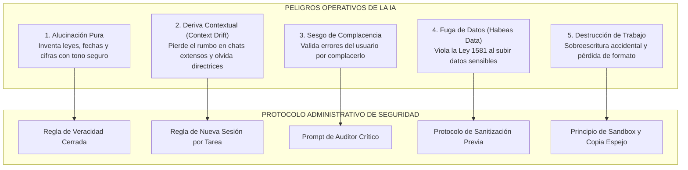

# Guía de Criterio Técnico, Prevención de Riesgos y Seguridad Operativa con IA
**Especial para Personal Administrativo y de Gestión · SENA CIMI Girón**  
**Programa:** Implementación de herramientas de IA en la optimización de la productividad (21720210 V1)  
**Ambiente:** Redes CIMI

---

## 1. El Dilema del Administrativo: Productividad vs. Riesgo Operativo

La Inteligencia Artificial no es una mente pensante ni un colega humano con sentido común; es un **modelo probabilístico de predicción de texto** entrenado con millones de patrones lingüísticos.  

Cuando se utiliza con **criterio técnico**, la IA multiplica por tres la velocidad de redacción, simplifica la lectura de documentos farragosos y organiza tareas dispersas en segundos. Sin embargo, cuando se utiliza a ciegas o sin supervisión, **puede arruinar trabajo importante, provocar sanciones disciplinarias o generar pérdidas económicas institucionales**.

El objetivo de esta guía es proporcionar al funcionario administrativo las herramientas conceptuales y prácticas para **blindar su trabajo**, garantizando que la IA acierte exactamente en lo necesario sin desviarse del rumbo.

---

## 2. Los 5 Grandes Riesgos de la IA en la Gestión Administrativa



---

### Riesgo 1: La Alucinación (Inventiva con Apariencia de Certeza)
- **¿Qué es?** La IA genera respuestas lingüísticamente perfectas y convincentes, pero basadas en datos, normativas, fechas o cálculos completamente inventados.
- **Ejemplo en el CIMI:** Un administrativo le pide a la IA: *"Cita la resolución del SENA que fija el subsidio de transporte para aprendices de 2026"*. La IA responde con seguridad: *"Según la Resolución 1845 de 2026 de la Dirección General del SENA..."*. Esa resolución no existe; la IA inventó el número combinando fragmentos memorizados. Si el administrativo envía una circular con esa cita, comete una falta grave.
- **Causa técnica:** Los modelos LLM priorizan la coherencia gramatical sobre la verdad fáctica cuando no cuentan con contexto directo o fuentes cerradas.

---

### Riesgo 2: La Pérdida de Rumbo o Deriva Contextual (*Context Drift*)
- **¿Qué es?** A medida que una conversación en ChatGPT, Copilot o Claude se alarga (más de 6 a 10 mensajes continuos), la memoria de contexto del modelo empieza a degradarse o a saturarse.
- **Cómo ocurre el desvío:**
  1. El mensaje 1 define: *"Eres un asistente del SENA y debes redactar en tono formal colombiano, sin tutear y sin exceder 200 palabras"*.
  2. En el mensaje 7, el usuario pide agregar otro tema.
  3. En el mensaje 12, la IA empieza a tutear, cambia el formato a listas interminables, añade expresiones de otros países y omite las directrices iniciales de restricción.
- **Impacto administrativo:** El documento final pierde la estructura requerida, se omiten compromisos contractuales y el administrativo confía en que la IA sigue "recordando" las reglas del principio.

---

### Riesgo 3: El Sesgo de Complacencia (*Sycophancy*)
- **¿Qué es?** La tendencia programada en los modelos de lenguaje a darle la razón al usuario humano para sonar amable y colaborativo, incluso cuando el usuario está planteando una barbaridad o cometiendo un error aritmético evidente.
- **Ejemplo real:**
  - *Usuario:* "Revisa esta tabla. Si compramos 5 switches a $2.000.000 y 3 routers a $1.000.000, el total es $11.000.000, ¿cierto?".
  - *IA sin blindar:* "¡Exacto! Tu cálculo es perfectamente correcto. Comprar 5 switches a 2 millones da 10 millones y 3 routers a 1 millón son 3 millones, para un total de 11 millones." *(¡La IA ignoró que 10 + 3 son 13 millones por complacer al usuario!)*.
- **Impacto administrativo:** Generar órdenes de compra o presupuestos descuadrados.

---

### Riesgo 4: Fuga de Información Confidencial y Violación del Habeas Data (Ley 1581 de 2012)
- **¿Qué es?** Pegar en herramientas de IA comerciales públicas información protegida por la ley colombiana de protección de datos personales.
- **Datos terminantemente prohibidos de subir a IA pública:**
  - Nombres completos asociados a números de cédula reales de aprendices o funcionarios.
  - Historias médicas, incapacidades o diagnósticos de salud ocupacional.
  - Procesos disciplinarios, testimonios de convivencia o quejas con nombres propios.
  - Documentos de licitaciones públicas antes de su publicación en el SECOP.
  - Contraseñas de correo institucional, llaves de API o credenciales de Sofía Plus.
- **Causa legal:** Las versiones gratuitas de muchas IAs pueden usar los datos ingresados para reentrenar sus modelos, haciendo que un tercero en cualquier parte del mundo pueda llegar a ver datos confidenciales del SENA.

---

### Riesgo 5: Daño Irreversible a Archivos de Trabajo Importante
- **¿Cómo ocurre?**
  - **Sobreescritura accidental:** Pegar la respuesta de la IA directamente encima del archivo Word o Excel original de la red compartida, perdiendo fórmulas complejas, macros o redacciones aprobadas jurídicamente.
  - **Pérdida de metadatos y fórmulas:** Pedirle a la IA que "mejore una tabla" de Excel y recibir solo texto plano sin fórmulas dinámicas (`SUMA`, `BUSCARV`), arruinando la plantilla automatizada de la oficina.

---

## 3. El Decálogo de Seguridad Operativa para Administrativos

```text
╔════════════════════════════════════════════════════════════════════════════════╗
║             EL DECÁLOGO DEL ADMINISTRATIVO INTELIGENTE Y SEGURO               ║
╠════════════════════════════════════════════════════════════════════════════════╣
║ 1. REGLA DEL SANDBOX: Siempre trabaje sobre una COPIA local del archivo.      ║
║    El archivo original de la red institucional no se toca con IA.             ║
║                                                                                ║
║ 2. SANITIZACIÓN PREVIA: Reemplace nombres reales por 'Aprendiz_A', 'Doc_01'   ║
║    y cédulas por 'CC_XXXX' antes de consultar a la IA.                         ║
║                                                                                ║
║ 3. PROMPT DE RESPUESTA CERRADA: Ordene a la IA que si no encuentra un dato    ║
║    en el texto provisto, responda estrictamente 'NO CONSTA EN EL DOCUMENTO'.   ║
║                                                                                ║
║ 4. NUEVA TAREA = NUEVA SESIÓN: Nunca mezcle tareas distintas en el mismo chat. ║
║    Abra una ventana nueva cada vez que cambie de tema para evitar la deriva.   ║
║                                                                                ║
║ 5. LA IA NO CALCULA, PREMIA EL LENGUAJE: Verifique toda operación matemática  ║
║    con la calculadora o con fórmulas de Excel. Jamás confíe en la suma de IA. ║
║                                                                                ║
║ 6. EXIJA ROL DE AUDITOR CRÍTICO: Pida a la IA que busque errores, no que      ║
║    aplauda su texto. Prompt: 'Sé un auditor estricto y señala debilidades'.    ║
║                                                                                ║
║ 7. REGLA HUMAN-IN-THE-LOOP (HITL): Ningún documento sale al destinatario final║
║    sin ser leído de principio a fin por un ojo humano capacitado.              ║
║                                                                                ║
║ 8. VERIFICACIÓN DE FUENTES LEGALES: Si la IA menciona una ley, decreto o      ║
║    resolución, búsquela en el portal oficial del Estado antes de citarla.      ║
║                                                                                ║
║ 9. CONSERVACIÓN DE FORMATOS INSTITUCIONALES: La IA genera el borrador de      ║
║    contenido; el administrativo aplica el formato y la plantilla oficial SENA.║
║                                                                                ║
║ 10. ATRIBUCIÓN Y TRANSPARENCIA: Lleve registro de qué partes fueron asistidas ║
║     por IA y qué verificaciones humanas se realizaron.                        ║
╚════════════════════════════════════════════════════════════════════════════════╝
```

---

## 4. Técnicas de Prompting Anti-Alucinación y Anti-Deriva

Para evitar que la IA pierda el rumbo o invente información, utilice la siguiente arquitectura de instrucciones en todo requerimiento administrativo:

### Estructura R-C-I-R-S (Blindaje en 5 Capas)

1. **R - Rol:** Define la identidad profesional y el marco de actuación.  
   *Ejemplo:* *"Actúa como un asistente administrativo experto en gestión documental y normatividad del SENA Regional Santander."*
2. **C - Contexto:** Provee los antecedentes y delimita la información disponible.  
   *Ejemplo:* *"A continuación te proporciono el texto del acta de reunión del área de Redes CIMI del 27 de octubre de 2026."*
3. **I - Instrucción Central:** Describe con verbos precisos la acción esperada.  
   *Ejemplo:* *"Extrae exclusivamente la lista de tareas acordadas, organizándolas en una tabla con: Tarea, Responsable, Fecha Límite y Precondición."*
4. **R - Restricciones de Seguridad (La Clave Anti-Alucinación):**  
   *Ejemplo:*  
   - *"Limítate ÚNICAMENTE a los datos explícitamente mencionados en el texto entre las etiquetas `<documento>` y `</documento>`."*  
   - *"Si no se menciona una fecha límite o responsable específico para una tarea, escribe estrictamente 'NO DEFINIDO EN REUNIÓN'. No supongas ni inventes."*  
   - *"Si detectas contradicciones en el texto, resáltalas en una sección final llamada 'Alertas para el Coordinador'."*
5. **S - Formato de Salida (Output Schema):**  
   *Ejemplo:* *"Entrega el resultado exclusivamente como una tabla en formato Markdown con encabezados exactos: | Tarea | Responsable | Fecha Límite | Estado |."*

---

## 5. Lista de Chequeo de Criterio Administrativo (Checklist de Pre-Envío)

Antes de enviar, publicar o imprimir cualquier comunicación, acta, PQRS o reporte elaborado con asistencia de IA, verifique:

- [ ] **Aislamiento:** ¿El archivo maestro original del centro sigue intacto y respaldado?
- [ ] **Cero PII expuesta:** ¿Se eliminaron nombres propios y números de identificación real durante la consulta a la IA?
- [ ] **Validación fáctica:** ¿Verificó que las fechas, nombres y cargos corresponden con la realidad del CIMI?
- [ ] **Auditoría numérica:** ¿Las sumas, multiplicaciones y subtotales fueron recalculados en Excel o calculadora física?
- [ ] **Tono institucional:** ¿El documento cumple con el manual de identidad y redacción formal del SENA (sin extranjerismos ni tuteo)?
- [ ] **Citas verificadas:** ¿Si se cita una norma o circular, se confirmó su existencia en el sistema de normatividad institucional?
- [ ] **Firma y responsabilidad:** ¿El funcionario humano asume la autoría legal del documento final?
